<p align="center">
  
</p>

# temporal-devdays-java

Every Temporal DevDays Workshop in Java: what exists, where each piece lives,
and what it cost to author.

All created via code. Use or repurpose the content to fit your next Dev Day!

## Workshops

| Workshop | Level | Stack | Deck | Code + Track | Lab | Duration | Author | Model | Deck cost ($) | Track cost ($) |
|---|---|---|---|---|---|--:|---|---|--:|--:|
| The Saga Pattern | Advanced | Java · compensation | Pending | [`workshops/saga-order-fulfillment/`](workshops/saga-order-fulfillment/) | [`saga-java`](https://play.instruqt.com/temporal/tracks/saga-java) | 45 min | Nikolay Advolodkin | Opus 5.5 (100%) | Pending | 4.73 |
| Child Workflows | Foundations | Java · child workflows | Pending | [`workshops/child-workflows/`](workshops/child-workflows/) | [`child-workflows-java`](https://play.instruqt.com/temporal/tracks/child-workflows-java) | 10 min | Nikolay Advolodkin | Opus 5.5 (100%) | Pending | 3.98 |
| Continue-As-New | Advanced | Java · event history | Pending | [`workshops/continue-as-new-subscription/`](workshops/continue-as-new-subscription/) | [`continue-as-new-java`](https://play.instruqt.com/temporal/tracks/continue-as-new-java) | 10 min | Nikolay Advolodkin | Opus 5.5 (100%) | Pending | 2.86 |
| Activity Heartbeats | Advanced | Java · activities | Pending | [`workshops/heartbeats-shipment/`](workshops/heartbeats-shipment/) | [`heartbeats-java`](https://play.instruqt.com/temporal/tracks/heartbeats-java) | 10 min | Nikolay Advolodkin | Opus 5.5 (100%) | Pending | 4.45 |

A Workshop created for this program lives here, under `workshops/<slug>/` with
its Deck in `decks/<slug>/`. A Workshop that already has a Temporal-owned topic
repo stays there and is linked from the **Code + Track** column; its Deck may
still live here. See [ADR 0001](docs/adr/0001-new-workshops-live-here-existing-ones-are-linked.md).

Costs are agent tokens only, a floor, not the full cost. **Model** names every
model that spent tokens on the Authoring, with its share of the dollars, so two
costs can be compared like for like. See [`docs/authoring/`](docs/authoring/)
for how they are measured.

**Every PR that adds a Deck or a Workshop adds its row here in the same PR.**
Fill in what the PR contains and mark the rest `Pending`. The **README index**
check runs `scripts/check-readme-index.sh` on every PR and fails it when a row is
missing; run it locally before opening the PR.

## Running a Workshop's code

You need Java 21, [Maven](https://maven.apache.org/) 3.9 and the
[Temporal CLI](https://docs.temporal.io/cli).

```bash
temporal server start-dev                     # terminal 1
cd workshops/<slug>/solution                  # or exercise
mvn -q compile exec:java@worker               # terminal 2
mvn -q compile exec:java@starter              # terminal 3, add -Dexec.args="..." for flags
mvn -q test                                   # no server needed
```

The Solution's tests must pass. The Exercise's tests fail until its TODOs are
done. Inside a Track's sandbox the same commands are `run-worker`, which also
restarts the Worker on every save, and `run-starter <args>`.

## Starting a new Workshop

```bash
cp -R workshops/_template workshops/<slug>
```

Then rename `workshop-slug` and the `io.temporal.devdays.greeting` package in
both `pom.xml` files, `Shared.java` and the Track files, and add a row to the
table above.

## Sandbox Images

Every Track boots an image built `FROM` the shared
[`sandbox-base/`](sandbox-base/) image: JDK 21, Maven, the Temporal CLI,
code-server with Java support, and the Check and Skip helpers
([ADR 0003](docs/adr/0003-one-shared-sandbox-base-image.md)). Before pushing,
prove a Track end to end in its local image:

```bash
bash scripts/test-checks.sh workshops/<slug>            # every Check gates its Challenge
bash scripts/test-track-local.sh workshops/<slug> <image>   # setup, check, solve, check
bash scripts/verify-content.sh                          # snippets match the code; one SDK per Workshop
```

## Vocabulary and decisions

[`CONTEXT.md`](CONTEXT.md) is the glossary. [`docs/adr/`](docs/adr/) records the
decisions behind this layout.
